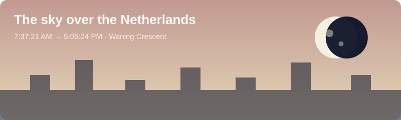

<h1 align="center">Hi, I'm Gia Hy 👋</h1>

  CS undergrad @ <b>TU Eindhoven</b> 🇳🇱 · originally from Vietnam 🇻🇳 

<!-- DATE:start -->
📅 **Friday, 06 November 2026** — refreshed 01:28 CET
<!-- DATE:end -->

---

### 🌌 The sky over the Netherlands right now
<!-- The SVG below is redrawn every few hours: colors shift with the local time of day,
     and the moon is rendered at its real phase. -->

  

<!-- SKY:start -->
🌅 **Sunrise** 7:39:06 AM  ·  🌇 **Sunset** 5:03:44 PM
✨ **Golden hour** 4:13:03 PM  ·  ⏳ **Day length** 9:24:37
🌘 **Moon**: Waning Crescent (8% lit)

> 🔭 *Saturn is less dense than water — it would float in a big enough bathtub.*
<!-- SKY:end -->

<!-- WEATHER:start -->
🌡️ **Eindhoven**: 4°C (feels 2°C) · Clear 
<!-- WEATHER:end -->
---

### 🧠 Dev fact of the day
<!-- FACT:start -->
💡 QWERTY was designed to slow typists down so mechanical typewriters wouldn't jam.
<!-- FACT:end -->

### 📰 What's hot on Hacker News
<!-- HN:start -->
- [Search for everyone](https://kagi.com/changelog#11820)
- [Claude Code sends your email address to websites](https://github.com/anthropics/claude-code/issues/107757)
- [MS Paint Remote Code Execution Vulnerability](https://www.cve.org/CVERecord?id=CVE-2026-83844)
- [sshole](https://sshhole.com)
<!-- HN:end -->

---

### 🐍 My week in code
<picture>
  <source media="(prefers-color-scheme: dark)" srcset="https://raw.githubusercontent.com/giahymai/giahymai/output/snake-dark.svg" />
  <source media="(prefers-color-scheme: light)" srcset="https://raw.githubusercontent.com/giahymai/giahymai/output/snake.svg" />
  
</picture>

---

