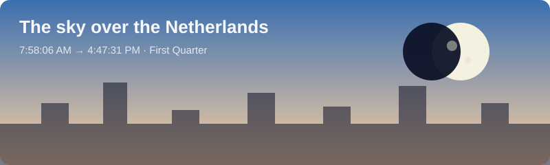

<h1 align="center">Hi, I'm Gia Hy 👋</h1>

  CS undergrad @ <b>TU Eindhoven</b> 🇳🇱 · originally from Vietnam 🇻🇳 

<!-- DATE:start -->
📅 **Wednesday, 18 November 2026** — refreshed 17:24 CET
<!-- DATE:end -->

---

### 🌌 The sky over the Netherlands right now
<!-- The SVG below is redrawn every few hours: colors shift with the local time of day,
     and the moon is rendered at its real phase. -->

  

<!-- SKY:start -->
🌅 **Sunrise** 7:59:46 AM  ·  🌇 **Sunset** 4:46:16 PM
✨ **Golden hour** 3:52:02 PM  ·  ⏳ **Day length** 8:46:29
🌓 **Moon**: First Quarter (60% lit)

> 🔭 *A day on Venus is longer than its year.*
<!-- SKY:end -->

<!-- WEATHER:start -->
🌡️ **Eindhoven**: 11°C (feels 8°C) · Moderate or heavy rain shower
<!-- WEATHER:end -->
---

### 🧠 Dev fact of the day
<!-- FACT:start -->
💡 The first 1GB hard drive (1980) weighed over 250 kg and cost $40,000.
<!-- FACT:end -->

### 📰 What's hot on Hacker News
<!-- HN:start -->
- [Quad9 Is Leaving France: Why DNS Resolvers Are the Wrong Place to Fight Piracy](https://techstackups.com/articles/quad9-leaves-france-dns-blocking/)
- ['Human' Is Cambridge Dictionary's Word of the Year 2026](https://www.cam.ac.uk/news/cambridge-dictionary-reveals-word-of-the-year-2026)
- [Can Peer Review Survive AI-Generated Text? [pdf]](https://www.sas.upenn.edu/~jesusfv/Peer_Review.pdf)
- [Energy-Based Reasoners: 385x more efficient inference](https://energy-based-reasoners.github.io/)
<!-- HN:end -->

---

### 🐍 My week in code
<picture>
  <source media="(prefers-color-scheme: dark)" srcset="https://raw.githubusercontent.com/giahymai/giahymai/output/snake-dark.svg" />
  <source media="(prefers-color-scheme: light)" srcset="https://raw.githubusercontent.com/giahymai/giahymai/output/snake.svg" />
  
</picture>

---

